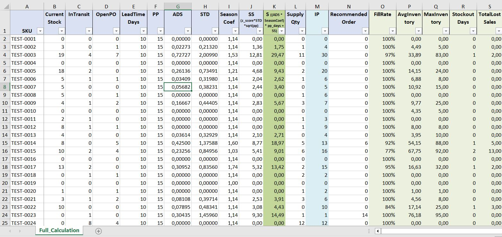

## Описание проекта
Разработка модели расчета рекомендуемого заказа (Recommended Order) для складских запасов с учетом сезонности, жизненного цикла товаров, ABC/XYZ-анализа и открытых поставок. Проект включает полный цикл: от разведочного анализа данных (EDA) до симуляции (бэктестинга) и сравнения с базовыми методами.

## Что реализовано:

*   **EDA (разведочный анализ):** Поиск аномалий, пропусков, анализ «мертвых запасов» (Dead Stock).
*   **Расчет ADS (Average Daily Sales):** С исключением дней дефицита (цензурирование спроса), чтобы не занижать прогноз.
*   **Учет сезонности:** Двухуровневый подход (макро-индекс по всем SKU + индивидуальные коэффициенты с защитой от статистического шума).
*   **Учет жизненного цикла (Product Lifecycle):** Классификация SKU на «Новинка», «Активный», «Выводится», «Закрыт/Выведен». Логика учитывает наличие остатков и товаров в пути (InTransit/OpenPO).
*   **ABC/XYZ-анализ:** Сегментация ассортимента по вкладу в продажи (ABC) и стабильности спроса (XYZ) с использованием квантилей.
*   **Расчет страхового запаса (Safety Stock) и целевого запаса (Target Level):** Формула `S = (ADS * SeasonCoef) * PP + SS`. Защитный период (PP) учитывает LeadTime и цикл заказов.
*   **Бэктестинг модели:** Симуляция работы склада на исторических данных без «подглядывания в будущее» (No Look-Ahead Bias). Сравнение с базовыми методами (Moving Average с окнами 7, 15, 30 дней).
*   **Экспорт полной аналитики в Excel:** Выгрузка всех промежуточных расчетов для проверки любого SKU.

## Результат:

Модель с сезонностью показала лучший баланс между уровнем сервиса и запасом по сравнению с базовыми методами:

       ================================================================================
       СРАВНЕНИЕ РЕЗУЛЬТАТОВ НА ТЕСТОВОМ ПЕРИОДЕ (01.06.2025 - 18.09.2025)
       ================================================================================
       Модель                              | Fill Rate  | Ср. запас  | Макс. запас  | Дефицит (дн) | Упущено (шт)
       -------------------------------------------------------------------------------------
       НАША МОДЕЛЬ (без сезонности)        |    96.78% |       23.5 |          901 |           75 |        640
       НАША МОДЕЛЬ (с сезонностью)         |    97.07% |       28.0 |          967 |           62 |        563
       БАЗОВАЯ (окно 7 дней)               |    96.95% |       21.3 |          840 |           82 |        597
       БАЗОВАЯ (окно 15 дней)              |    97.56% |       58.1 |         3714 |           56 |        376
       БАЗОВАЯ (окно 30 дней)              |    98.04% |      128.3 |         9037 |           48 |        357
       -------------------------------------------------------------------------------------
Вывод: Модель с сезонностью обеспечивает высокий уровень сервиса (97.07%) при значительном сокращении дефицита и упущенных продаж по сравнению с базовой моделью (7 дней). Более долгие окна (15, 30 дней) дают формально высокий сервис, но ценой огромного избытка запасов (Max Inventory достигает 9037 шт.).

Полная таблица со всеми промежуточными расчетами (для проверки любого SKU):

## Стек
Python (Pandas, NumPy), Excel, Backtesting.

## Как запустить:
Установите зависимости:

bash
pip install pandas numpy openpyxl xlsxwriter
Запустите скрипт:

bash
python main_Lifecycle_ABC_XYZ.py

*Примечание: Для запуска требуется файл с историческими данными (не включен в репозиторий).*
